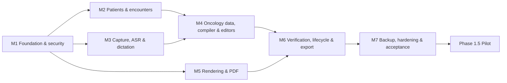

# Oncology OPD Documentation App: Delivery Roadmap

**Source:** `oncology_opd_app_requirements.md` (PRD v1.0, 21 Oct 2026)
**Roadmap version:** 0.3 (draft for review)
**Date:** 21 October 2026
**Status:** Proposed. Durations are indicative and must be re-baselined at the end of Phase 0.

**Change log**
- 0.3: Platform set to an **Electron** desktop app on a **16 GB Ryzen Windows laptop**.
  Primary engine is now **Oriserve Whisper-Hindi2Hinglish-Apex** (whisper.cpp, Vulkan), with
  Parrotlet-a kept as the accuracy reference on the Mac. Added §2.2 (Parrotlet training data
  is not available) and §2.3 (fine-tuning plan for Apex).
- 0.2: Speech model chosen: **Eka Care Parrotlet-a 2.5 Pro**. Added §2.1 (its implications),
  changed the Phase 0 ASR work from a model bake-off to model validation, made the platform
  decision depend on the model's hardware needs, and reworked M3 (chunking, diarisation,
  local inference service).
- 0.1: Initial draft.

---

## 1. How this roadmap is organised

The PRD defines four delivery phases (0–3). This roadmap keeps them and breaks the large
Phase 1 (Offline MVP) into seven dependency-ordered milestones. Each one has a goal, a
scope given as PRD requirement IDs, deliverables, and exit criteria that can be tested.

| Phase | Name | Outcome | Indicative duration |
|---|---|---|---|
| 0 | Discovery & device/model validation | Validated device, ASR model, template, and policy decisions | 4–5 weeks |
| 1 | Offline MVP (M1–M7) | Every P0 requirement and all 20 acceptance criteria pass | 16–20 weeks |
| 1.5 | Controlled clinical pilot | Clinical safety sign-off for routine use | 4–6 weeks |
| 2 | Workflow improvements | P1 requirements, faster correction, better extraction | 10–14 weeks |
| 3 | Secure online capabilities | Authenticated, audited, conflict-safe sync and integrations | 16+ weeks (scoped separately) |

**Assumed team for the estimates:** 2 mobile engineers, 1 engineer for ASR/ML and
native code (part-time after Phase 0), 1 QA engineer (from M3), and a clinician champion
for about 2–4 hours a week, plus a reviewer for compliance and security at the gates.

### Guiding principles (taken from the PRD)

1. **No invention by construction.** Every compiled field must trace to a transcript,
   a dictation, a manual entry, or an explicit selection. Accuracy can be improved later,
   but this guarantee must hold from M4 onward.
2. **The core workflow works without AI.** Typing fallback, manual structuring, and manual
   medication entry must be complete before any automated extraction is added. AI only
   speeds up the workflow; nothing depends on it.
3. **Safety gates go in early.** The verification state machine, export gating, and
   audit log are designed in M1 and enforced from M6. They are not added at the end.
4. **Privacy is a release requirement.** Encryption, log scrubbing, and the retention
   policy are part of the foundation (M1/M3), not the hardening milestone.
5. **Sync-ready, not sync-enabled.** Stable IDs, versioned records, and a repository layer
   from day one. No network code ships in Phase 1.

---

## 2. Gaps and inconsistencies in the PRD (resolve in Phase 0)

Reading the PRD as a whole turned up several places where a P1 item is actually needed
for the P0 workflow to work. Proposed resolutions:

| # | Issue | Why it matters | Proposed resolution |
|---|---|---|---|
| G1 | **PAT-06** (manual registration) is P1, but the reception system is unknown and no integration exists | The MVP has no way to get patients into the app | Promote manual registration **and** CSV import (through the replaceable patient adapter) to P0 |
| G2 | **CMP-12** (English output from Hinglish) is P1, but objective 1.1 and AUD-04 expect English documentation | Decides whether the MVP needs a translation/normalisation model | Settle it with Open Decision #9 in Phase 0. MVP default: the transcript stays Hinglish, and the history fields are produced in English through *assisted* normalisation that the doctor confirms |
| G3 | **PDF-12** (letterhead calibration) is P1, but the risk register and acceptance criterion 11 need correct alignment on the real letterhead | Without calibration, MVP printouts may be misaligned | MVP ships a minimal X/Y offset and margin calibration with a test print. The full alignment workflow stays in Phase 2 |
| G4 | **CMP-08** (source traceability) is P0, but Phase 2 lists "source-to-field traceability" | The required level of traceability is unclear | MVP: each field records its source type and source record ID. Phase 2: links down to the transcript span |
| G5 | Local users and roles are implied (lock screen, VER-07 records the verifier, reception cannot verify), but "authentication & RBAC" appears only in Phase 3 | VER-07 cannot be met without user identity | MVP includes **local** user accounts (Doctor, Staff) with a PIN or biometric. Phase 3 adds networked identity |
| G6 | **AUD-12** (external mic) is P1, but Phase 0 chooses a microphone and AUD-01 mentions external mics | If Phase 0 picks a lapel mic, the MVP must support it | Whichever mic Phase 0 selects becomes P0 support for that one device. Broader mic support stays P1 |
| G7 | **ONC-04** ("don't assume unasked symptoms are absent") doesn't fit the example schema's boolean/array style | Empty or false values could be read as clinical negatives | Model symptoms and toxicities as **tri-state**: `present`, `absent`, `not_assessed` (default), plus an optional grade and source |
| G8 | The schema has one `verification` block, but VER-09 and STO-09 require traceable amendments | Overwriting the block destroys history | Store **immutable document revisions**. Each verification is tied to a revision and its content hash, and an amendment creates a new revision |
| G9 | "Clinically relevant edit" (VER-06) is not defined | The verification invalidation rule cannot be implemented | Safe default: **any change to rendered content** invalidates verification. Only purely presentational settings are exempt |

### 2.1 Platform and speech engine decisions

**Target platform (decided):** an **Electron desktop app**. Production runs on a
**Windows laptop with a Ryzen CPU and 16 GB RAM**, with no discrete GPU assumed.
Development happens on an M1 Pro Mac. The app runs entirely on that one laptop, offline.

**Primary speech engine (proposed):** **Oriserve Whisper-Hindi2Hinglish-Apex**, a
0.8B-parameter fine-tune of Whisper large-v3-turbo under the Apache-2.0 licence.
- **Output:** Hinglish in Roman script, so English drug names stay in English letters.
- **Runtime:** converted to whisper.cpp (ggml) format and quantised (q5/q8). Uses the
  **Vulkan** backend on the Ryzen's Radeon built-in GPU, and Metal on the dev Mac.
  It runs as a native sidecar process.

**Reference engine:** **Eka Care Parrotlet-a 2.5 Pro**. It's too heavy for the target
laptop: about 10 GB of weights, PyTorch only, and it needs a GPU. It is kept only as the
accuracy benchmark on the Mac, and as a future option if the clinic gets a GPU machine.

| # | Fact / constraint | Impact | Roadmap response |
|---|---|---|---|
| S1 | **Apex is not trained on medical speech.** It was tuned on about 700 hours of general noisy, Indian-accented Hindi. Its published WER is 30–48% on general benchmarks after transliterating the references | Drug names, doses, and clinical terms will have more errors than with a medical model | Prime it with the clinic formulary through `initial_prompt` / hotwords. Make doctor dictation the main source for exam, assessment, and plan. A lexicon check **flags** drug names that don't match the formulary (it never auto-corrects them). Domain fine-tuning comes in Phase 2 (§2.3) |
| S2 | **Whisper processes 30-second windows** and can hallucinate on silence | Content could be lost at chunk edges, or text could be made up during silence | Voice-activity chunking (≤ 25 s, cut at pauses) with a **coverage invariant**: every second is either transcribed or flagged. Chunks that are only silence are skipped, and repeated or looping output is detected and flagged |
| S3 | **No speaker labels** | AUD-08/09 need speaker labels from somewhere | A lightweight local diarisation step, or segment-level manual labelling in the MVP. Labels always start as *uncertain* |
| S4 | **CPU and built-in GPU throughput on the Ryzen is unknown.** An older Ryzen 4750U reportedly ran turbo at 0.8× realtime on CPU and 3.4× on its built-in GPU | Transcripts may be slow to appear | Transcribe chunks **while recording continues**. Phase 0 measures speed on the actual laptop. Mac (Metal) numbers do not transfer |
| S5 | **16 GB RAM is shared** by Electron, the model (about 1–1.5 GB quantised), PDF rendering, and Windows itself | Memory pressure on a busy clinic day | A memory budget is part of the M3 and M7 exit criteria. Load one model at a time |
| S6 | **Electron security** | A desktop web runtime that handles health data | `contextIsolation` on, `nodeIntegration` off, a strict CSP, no remote content, a typed IPC allow-list, signed builds, and auto-update **disabled** in the MVP (offline) |

**Electron stack (to confirm in ADRs):**
- **Database:** SQLite with SQLCipher-compatible encryption (for example
  `better-sqlite3-multiple-ciphers`). The key is wrapped with Electron `safeStorage`
  (DPAPI on Windows, Keychain on macOS).
- **PDF:** HTML/CSS templates rendered with Chromium `printToPDF`. CSS
  `break-inside: avoid` keeps medication entries together. The letterhead PDF is
  overlaid with `pdf-lib`.
- **Speech:** whisper.cpp sidecar, communicating over stdio or a named pipe with no network
  port. Mic capture uses Web Audio, resampled to 16 kHz.

### 2.2 Using Parrotlet's training data for Apex: not possible

- **Eka has not published Parrotlet's training data.** It is very likely real patient
  audio and is not available. None of Eka's 20 public datasets is described as Parrotlet
  training data.
- **What is public** is the *Eka Medical ASR Evaluation Dataset* (MIT licence; about 3.6k
  English and 320 Hindi test rows, with labelled drugs, findings, advice, and diagnostics).
  It is published as a **test** split. **Use it to evaluate Apex against Parrotlet, not
  to train.** Training on it would make the benchmark meaningless.
- **Distillation** (using Parrotlet's outputs as labels to train Apex) is technically
  possible. However, Gemma-family licence terms typically count models trained on a
  model's outputs as derivatives. That would likely put the fine-tuned Apex under the
  HAI-DEF terms. **Legal review is needed before attempting it.**

### 2.3 How to get medical accuracy into Apex instead (Phase 2)

1. **Clinic-owned data (best long-term source).** The app already stores the original ASR
   output and the doctor's corrections (AUD-11). With **explicit patient consent and a
   retention policy that allows it**, the pilot can produce audio paired with corrected
   transcripts from real consultations in your own clinic. That needs its own consent
   flow, de-identification, and storage separate from clinical records.
2. **Synthetic medical speech.** Scripts in Hinglish built from the clinic formulary,
   oncology regimens, and dosing phrases, voiced by staff role-play and/or Indic TTS.
   This is cheap and works well for teaching the model drug names.
3. **Public Hindi speech** (for example IndicVoices, Common Voice Hindi), transliterated
   to Roman Hinglish, mixed in so the model doesn't forget general Hindi.
4. **Training:** LoRA or full fine-tuning on a rented or free GPU (Kaggle, Colab, or
   Modal credits) using **only synthetic, public, or consented and de-identified data**.
   The result is Apache-2.0 and can be shipped. Re-validate against the Eka test set and
   the clinic corpus before deploying.

---

## 3. Phase 0: Discovery and device/model validation (4–5 weeks)

**Goal:** Remove the biggest technical risk (offline Hinglish ASR on clinic hardware) and
close the open decisions that block implementation.

### 3.1 Workstreams

| Workstream | Activities | Deliverable |
|---|---|---|
| **Clinic inputs** | Collect the anonymised letterhead (PDF/image) and a sample note and prescription. Identify the reception software, vendor, and export options | Template pack; reception-integration memo |
| **Speech engine validation** | Record a **synthetic, role-played** Hinglish consultation corpus with clinic staff, scripted to include drug names (branded and generic), numbers, dates, laterality, and negation (no real patient data). Run **Apex (whisper.cpp, quantised) on the Ryzen laptop** and **Parrotlet-a 2.5 Pro on the Mac** as the reference, with formulary prompting on and off. Also score both on the Hindi and English subsets of the public Eka medical ASR **test** set. Build the chunking prototype (S2) and test diarisation (S3) | Comparison report: clinical-token error rate (drugs, numbers, negation, laterality), medical-entity accuracy, WER, processing time per minute of audio **on the Ryzen**, peak RAM, coverage/truncation tests, hallucination on silence |
| **Device & platform** | On the actual Ryzen laptop: record the exact CPU and built-in GPU model, check the Vulkan backend works, and test mic quality (built-in and lapel), Windows mic permissions, the A4 printing path, and letterhead alignment. Electron spike: encrypted SQLite, `safeStorage`, whisper.cpp sidecar, `printToPDF` | Platform ADR; minimum hardware spec |
| **Model licences** | Confirm Apache-2.0 obligations for Apex and whisper.cpp (MIT). Parrotlet's HAI-DEF terms only matter if it is used beyond benchmarking or for distillation (§2.2) | Section in the compliance memo |
| **Clinical workflow definition** | With the clinician: mandatory fields per visit type, first cancer-specific templates, toxicity list, which warnings block finalisation and which can be acknowledged | Field catalogue v1; review-rules matrix |
| **Policy** | Consent-to-record workflow, audio retention default, sharing/export channels, backup location, doctor identity and signature method | Signed-off policy sheet |
| **Compliance scoping** | Initial review of applicable Indian requirements (for example, the DPDP Act 2023 and its rules, and medical-council prescription requirements). Engage legal/compliance advice as the PRD requires | Compliance requirements memo (not a legal determination) |
| **Architecture** | Module boundaries (PRD §8.4), schema v1 including the G7/G8 refinements, status state machine, ASR engine interface and whisper.cpp sidecar design, Electron security baseline (S6), PDF library choice (check the licence: avoid AGPL libraries unless compliant) | Architecture decision records (ADRs) |

### 3.2 Open decisions: owner and deadline

| PRD decision | Needed before | Default if still unresolved |
|---|---|---|
| 1. Reception software | M2 | Manual registration + CSV import adapter |
| 2. Target device | Decided | Ryzen Windows laptop with 16 GB RAM, Electron app (§2.1) |
| 3. Letterhead sample | M5 | Build against a placeholder; M5 cannot exit without the real one |
| 4. Separate or combined PDF | M5 | Support both through configuration; default is two documents |
| 5. Audio retention | M3 | Delete raw audio after transcript confirmation (PRD default) |
| 6. Consent workflow | M3 | Mandatory consent confirmation before recording, logged in the audit trail |
| 7. Doctor identity / signature | M5/M6 | Printed name and registration number only; no signature image |
| 8. Required oncology fields | M4 | Minimal set: summary, ECOG, toxicity checklist, vitals, clearance |
| 9. Language behaviour | M3 | Hinglish transcript; English note produced by confirmed normalisation |
| 10. Sharing policy | M6 | Local save and print only |
| 11. Backup location | M7 | Encrypted file to removable storage or an approved device |
| 12. Blocking vs acknowledgeable warnings | M6 | All medication-completeness and identity warnings block |

### 3.3 Exit criteria (go/no-go gate)

- [ ] Apex validated on the Ryzen laptop, with its gap to Parrotlet measured. Acceptance
      thresholds for clinical-token error rate and processing time are agreed with the
      clinician. (The PRD forbids promising numbers before testing, so thresholds come from
      this data.)
- [ ] Chunking passes the coverage test: no audio is lost at the 30-second window, and no text is made up during silence.
- [ ] Letterhead and sample layout received and approved.
- [ ] Gaps G1–G9 resolved and the PRD updated (v1.1).
- [ ] Field catalogue, review-rules matrix, and policy sheet signed off.
- [ ] Phase 1 plan re-baselined against the actual team and device.

**If Apex fails validation:** first try formulary prompting plus a close-talk mic. Then
try plain Whisper large-v3-turbo for English dictation. Then bring forward the §2.3
fine-tuning. If the clinic can add a GPU machine, Parrotlet-a becomes an option. If no
engine passes, go ahead with a **dictation-first MVP**. Conversation
capture still records and transcribes, but it is presented as a low-confidence reference.
The note is built mainly from doctor dictation and typing. Every P0 item can still be met
because the workflow never depended on AI accuracy.

---

## 4. Phase 1: Offline MVP (16–20 weeks)

### 4.1 Milestone dependency graph

### 4.2 Indicative schedule

| Week → | 1–3 | 4–5 | 6–9 | 8–11 | 10–13 | 12–14 | 15–18 |
|---|---|---|---|---|---|---|---|
| M1 Foundation | ███ | | | | | | |
| M2 Patients | | ██ | | | | | |
| M3 Capture/ASR | | ░░ (native ASR integration starts) | ████ | | | | |
| M4 Compiler/editors | | | | ████ | | | |
| M5 PDF | | | | ░░ (layout engine) | ████ | | |
| M6 Verification | | | | | | ███ | |
| M7 Hardening | | | | | | | ████ |

A cross-cutting **safety test suite** and **offline regression run** grow with every milestone.

---

### M1: Foundation, data model, and security (weeks 1–3)

**Goal:** A secure, offline skeleton that every later milestone builds on.

**Scope:** STO-01, STO-02, STO-03, STO-07, Screen 1 (Lock/Access), local roles (G5),
§4.10 architecture rules.

**Deliverables**
- Module skeleton matching PRD §8.4 (repository, audio, ASR, transcript, compiler,
  oncology, verification/audit, renderer, backup, sync-adapter stub).
- Encrypted local database (for example SQLite with an encryption layer). Keys are held in
  Electron `safeStorage` (DPAPI on Windows, Keychain on macOS). Full-disk encryption is required on the device as well. Schema v1 with migrations and a migration
  test harness.
- Domain model: stable UUIDs for patient, encounter, document, and revision. Tri-state
  clinical findings (G7). Immutable document revisions (G8). A field provenance structure
  (`source_type`, `source_id`, `confidence`, `review_status`).
- Encounter status state machine (PRD Appendix B) implemented as a pure, unit-tested module.
- Append-only audit log primitive.
- Local user accounts with Doctor and Staff roles, PIN/biometric unlock, and auto-lock
  on inactivity.
- **Logging policy:** a structured logger that only accepts allow-listed fields,
  crash reporting with no PHI (or disabled), no PHI in notifications, and screenshot
  protection on clinical screens.
- CI pipeline: unit tests, schema migration tests, a static "PHI in logs" lint check.

**Exit criteria**
- Data persists across app restarts (AC-16).
- An automated test scans logs and crash output after a scripted session and finds no
  synthetic PHI markers (AC-18, first pass).
- The database file is unreadable without the key. Staff accounts cannot reach any
  verification API.

---

### M2: Patients and encounters (weeks 4–5)

**Goal:** Find or register the right patient, open a visit, and make wrong-patient errors
hard to commit.

**Scope:** PAT-01–05, PAT-08, PAT-06 + CSV import (promoted, G1), ONC-01, ONC-08,
Screens 2, 3, 4, 13 (list view).

**Deliverables**
- Patient data adapter interface with two implementations: manual registration and CSV import
  (with field mapping and validation). The interface leaves room for a future reception
  system adapter.
- Patient search by MRN/OPD number and configured demographic fields.
- Patient profile with demographics, allergies, the longitudinal oncology summary (each
  field shows its **source and date**, ONC-08), and a list of prior visits.
- New Visit screen: identity confirmation step, visit date/time, encounter creation.
- **Persistent identity banner** (name, MRN, age/sex) on every clinical screen (PAT-04).
- Encounter binding guard: every transcript, dictation, and document carries an
  `encounter_id` that is checked on write. Switching patients mid-flow needs explicit
  confirmation (PAT-08).

**Exit criteria**
- AC-1 and AC-2 pass with the network disabled.
- Tests prove a transcript or document cannot be saved against a mismatched encounter.

---

### M3: Conversation capture, offline ASR, and dictation (weeks 4–9)

**Goal:** Record locally, transcribe Hinglish offline, and let the doctor correct
everything.

**Scope:** AUD-01–11, DIC-01–05, STO-04, STO-05, consent workflow, Screens 5, 6, 7.
External mic support only if Phase 0 selected one (G6).

**Deliverables**
- Audio capture service with states recording, paused, processing, stopped, and
  discarded. A persistent recording indicator. Recording survives screen lock and sleep.
  Interruption handling for device changes such as a mic being unplugged.
- Consent confirmation step before the first recording, recorded in the audit log.
- `SpeechRecognizer` engine interface, with the **Apex whisper.cpp sidecar** behind it
  (Vulkan on the Ryzen, Metal on the dev Mac; stdio or named-pipe IPC, no network port):
  - Model loaded once at app start, with a warm-up and a health check. A clear
    "model not ready" state.
  - Voice-activity chunking (≤ 25 s, cut at pauses), 16 kHz resampling, and transcription
    of chunks in a background queue *while recording continues* (S2).
  - **Coverage invariant:** chunk boundaries must cover the whole recording. Any gap or
    failed chunk shows as a visible "[untranscribed audio mm:ss–mm:ss]" marker and a
    review flag. Content is never dropped silently.
  - Clinic formulary injected as the initial prompt. Drug names that don't match the
    formulary are flagged, never auto-corrected (S1).
  - Hallucination guard: chunks that are only silence are skipped, and repeated or
    looping output is flagged (S2).
  - Model files are pinned by checksum. Inference makes no network calls (checked by an
    offline test).
- Local diarisation step that aligns speaker turns to chunks. Every label starts as a
  suggestion (S3).
- Transcript model: the **original ASR output is immutable**, and corrections are stored
  as tracked edits (AUD-11). Speaker labels are suggestions. Low-confidence labels are
  visibly marked and can be changed per segment (AUD-08, AUD-09).
- Transcript Review screen: inline editing, bulk speaker relabelling, and a "confirm
  history" action.
- Doctor Dictation screen: separate Examination, Assessment, and Plan controls. Each
  dictation is stored under its section (DIC-02), visually separated from patient-reported
  history (DIC-04), with a typing fallback (DIC-05).
- Audio retention: raw audio is deleted by default after the transcript is confirmed.
  Retention is configurable, and a clear UI shows whether audio is still stored.
- Hinglish→English normalisation per the Phase 0 decision (G2). Its output is always
  shown next to the source text and confirmed by the doctor.

**Exit criteria**
- AC-3, 4, 5, 6, and 17 pass offline on the chosen device.
- A 15–20 minute consultation transcribes within the processing time agreed in Phase 0,
  with no crash, data loss, or memory pressure.
- Truncation tests pass: 31 s, 5 min, and 25 min recordings with no pauses lose no
  audio. Every second is either transcribed or flagged.

---

### M4: Oncology data, compilation, and editors (weeks 8–11)

**Goal:** Turn sources into structured, editable, traceable fields without inventing
anything.

**Scope:** CMP-01–10, ONC-02–07, ONC-09, ONC-10, RX-01–07, Screens 8, 9, 10.

**Deliverables**
- **Oncology Review screen:** cancer summary editor (configurable fields, so biomarkers
  are not forced on every cancer type), ECOG 0–4 or "not recorded", a configurable
  toxicity checklist (tri-state, defaulting to *not assessed*), vitals, investigations
  reviewed, chemo clearance (Yes/No/Defer with a required reason), and regimen, cycle,
  day, last treatment date, and next planned treatment. The app never computes a dose.
- **Clinical compiler (deterministic-first):**
  - Routes sources by provenance: confirmed conversation → history sections; Examination
    dictation → examination; Assessment dictation → "assessment as documented by doctor";
    Plan dictation → plan.
  - Dictated text is carried **verbatim** by default. Any normalisation is shown as a diff
    and needs confirmation.
  - Empty sources produce "Not documented" or blank, per the template (CMP-06). They never
    produce a default value.
  - An optional extraction step (rules-based in the MVP) that may *suggest* medication
    fields from Plan dictation. It always keeps `source_text`, and every suggested entry
    starts with `review_required = true`.
- **Review flag engine** implementing PRD §7.3: missing dose/route/frequency/duration,
  ambiguous numbers, dates, laterality, and negation, uncertain speakers, contradictions
  between sources, missing mandatory fields, and identity problems. Each flag has a
  severity (blocking or acknowledgeable) taken from the Phase 0 rules matrix.
- **Structured Note Editor:** every field is editable (CMP-07) and shows a source chip
  linking back to its origin (CMP-08, field-level per G4).
- **Prescription Editor:** multiple medication entries with fields for name, strength,
  dose, route, frequency, duration, quantity, and instructions. Medicines, investigations,
  advice, return precautions, and follow-up are kept separate (RX-07). Doctor wording is
  preserved when parsing is uncertain (RX-03). Missing values are never inferred (RX-04).
- Clinic-configured content only: no hard-coded thresholds or emergency text (ONC-10).

**Exit criteria**
- AC-7, 8, 9, and 10 pass.
- **The no-invention suite passes**: a golden set of at least 30 synthetic cases
  (negation, unasked symptoms, partial doses, laterality, conflicting statements) checks
  that no compiled field lacks a source, and that no tri-state field moves off
  `not_assessed` without a source.

---

### M5: Rendering, letterhead, and PDF (weeks 10–13)

**Goal:** Readable, correctly paginated A4 documents on the real letterhead.

**Scope:** PDF-01–08, PDF-10, RX-08, minimal calibration (G3), Screen 12 (preview part).

**Deliverables**
- Template model that renders from structured data, never from free-text concatenation.
  Templates are versioned.
- Letterhead as a background (PDF or image), with an option for the first page only or
  every page.
- Pagination engine with keep-together rules: a medication entry never splits across
  pages (PDF-04), headings never sit at the bottom of a page alone, and long sections
  continue on the next page with a "continued" marker. Page X of Y.
- Patient demographics and visit date/time in configured positions on every page (PDF-05).
- Footer, registration details, and signature area preserved (PDF-10).
- Separate or combined OPD Note and Prescription/Plan output, per configuration (PDF-06).
- In-app preview of the **actual rendered PDF** (PDF-07).
- Calibration: X/Y offset and margin adjustment with a test-print page.
- Print through the platform print framework, and local save (PDF-08). Both stay
  disabled until M6 enables gating.

**Exit criteria**
- AC-11 and AC-12 pass on the **actual clinic printer and paper**.
- Automated layout tests: rendering the stress fixtures (25 medications, very long
  history, long Unicode drug names) loses no text when PDF text is extracted and
  compared with the source data.

---

### M6: Verification, lifecycle, and gated export (weeks 12–14)

**Goal:** Nothing leaves the device unless a doctor has explicitly verified the current
version.

**Scope:** VER-01–09, RX-09, PDF-09, STO-08, STO-09, Screens 11, 12 (export part), 13.

**Deliverables**
- Review and Verification screen: patient identity, the full note, the prescription with
  each medication's fields shown one by one (VER-03, VER-04), and all unresolved flags.
  Blocking flags prevent verification. Acknowledgeable flags need an explicit
  acknowledgement, which is logged.
- Explicit verification action (re-authentication with PIN or biometric) restricted to
  the Doctor role. It records the user, timestamp, revision ID, and **SHA-256 hash of the
  rendered content** (VER-02, VER-07).
- Invalidation: any content change after verification produces a new draft revision and
  clears the verified state (VER-06, G9).
- Single export gate: print, save, and share all go through one service that checks
  `verified && hash matches`. The check is enforced in the domain layer, not only in the UI.
- Amendment workflow: reopening a finalised visit creates an amendment revision with a
  required reason. The original verified revision stays immutable and viewable (VER-09).
- No automatic signature. A signature image (if configured in Phase 0) is applied only
  when the doctor explicitly enables it per document (VER-08).
- Status display (Draft, Transcribing, Needs Review, Ready for Verification, Verified,
  Amended) and export/print events in the audit log.
- Visit History screen: prior notes, prescriptions, amendments, and status.

**Exit criteria**
- AC-13, 14, and 15 pass.
- Tests show the export service rejects unverified or hash-mismatched documents even
  when the UI is bypassed.

---

### M7: Backup, settings, hardening, and acceptance (weeks 15–18)

**Goal:** A release candidate that passes all 20 acceptance criteria on the clinic device.

**Scope:** STO-06, Screen 14 (Settings), PRD §9, §10, AC-19, AC-20.

**Deliverables**
- Encrypted backup and restore with a backup passphrase separate from the device key.
  Integrity check on restore. Restore tested on a factory-reset device.
- Settings screen: clinic details, letterhead and calibration, transcription model,
  audio retention, backup, and template preferences (admin actions are logged).
- Retention jobs for audio, transcripts, PDFs, and backups, following policy.
- Security review: threat model, storage and log inspection, backup file analysis,
  lock-screen bypass attempts, and an export-gate bypass attempt.
- Performance and endurance: a full clinic day of consultations on the device (storage
  growth, thermals, battery).
- Full acceptance run (AC-1 to AC-20) with **the network disabled**, using synthetic
  cases that include errors in medication names, negation, numbers, dates, laterality,
  and speakers.
- Release documentation: user guide, admin/backup runbook, known limitations.

**Exit criteria (Phase 1 done)**
- [ ] Every P0 requirement is traced to a passing test (see §8).
- [ ] All 20 acceptance criteria pass on the clinic device and printer.
- [ ] Security review findings are fixed or formally accepted.
- [ ] Clinician signs off on the synthetic-case acceptance run.

---

## 5. Phase 1.5: Controlled clinical pilot (4–6 weeks)

The PRD requires a controlled pilot before routine clinical use (§14).

1. **Shadow mode (2–3 weeks):** The doctor uses the app alongside the existing
   documentation process. App output is compared with the doctor's normal note, and the
   app is not the record of care.
2. **Supervised use (2–3 weeks):** The app becomes the documentation path, and verified
   outputs are reviewed weekly.

**Metrics:** documentation time per visit, transcript correction rate, number of edits
per field, flag precision (useful vs noise), **any instance of invented content (target:
zero, investigated as a safety incident)**, wrong-patient near misses, and crash or
data-loss events.

**Exit:** Clinical safety sign-off, compliance review complete, and go-live decision.

---

## 6. Phase 2: Workflow improvements (10–14 weeks, after pilot learnings)

Order these by pilot data. The proposed grouping:

| Theme | Scope |
|---|---|
| **Transcription quality** | AUD-12 (broader mic support), AUD-13 (confidence highlighting, building on the S4 spike), AUD-14 (re-process a segment with a different model through the engine interface), better diarisation |
| **Domain fine-tuning of Apex** | §2.3: data from consented clinic corrections + synthetic medical speech + public Hindi; LoRA fine-tune; re-validate before deploying |
| **Platform reach** | macOS build from the same Electron codebase. Optional GPU machine running Parrotlet-a for higher accuracy |
| **Extraction & language** | CMP-12 (full Hinglish→English output, if not finished in the MVP). Evaluate a local LLM for section classification and medication extraction **behind the same compiler interface**, gated by the no-invention suite and a measured precision/recall benchmark |
| **Speed of correction** | Span-level source traceability (G4 phase 2), keyboard/quick-pick correction tools, RX-10 doctor-approved snippets |
| **Templates & terminology** | CMP-11 visit templates, CMP-13 abbreviations/terminology, ONC-11 cancer-specific templates and toxicity grading scales (for example, CTCAE if the clinic chooses it), DIC-06 extra dictation sections |
| **Oncology depth** | ONC-12 lab, imaging, and pathology trend views; richer longitudinal timeline |
| **Integration & data** | PAT-07 documented reception system import path, STO-10 encrypted device migration |
| **Output** | PDF-11 full template configuration, PDF-12 full calibration workflow, VER-10 pre-share confirmation screen |

**Gate for any AI extraction feature:** zero no-invention suite failures, and a benchmark on
synthetic cases reviewed by the clinician before the feature is enabled by default.

---

## 7. Phase 3: Secure online capabilities (scoped separately)

**Prerequisites before any network code ships** (PRD §4.10, §9, and the PRD statement that
sync is "not simply an upload button"):

1. Backend architecture and API contract, threat model, and hosting/data-residency decision.
2. Authentication (networked identity) and role-based authorisation, including admin role
   restrictions (PRD §2.3).
3. TLS everywhere, encrypted at rest on the server, and server-side audit logging.
4. Sync protocol built on record states and revisions: a conflict model that **never
   overwrites clinical data silently** (verified revisions are immutable, and
   conflicting drafts go to the user to resolve).
5. Consent and notice updates. Compliance review for cloud processing.

**Delivery slices:** (a) auth + RBAC → (b) one-way encrypted backup to the cloud → (c)
two-way sync of drafts and verified revisions with conflict UI and sync status → (d)
reception system/EMR integration → (e) controlled transfer of verified documents with
the VER-10 confirmation → (f) multi-device access per clinic policy. Audio is never
uploaded by default.

---

## 8. Traceability: P0 requirements and acceptance criteria → milestones

| Requirement group | P0 IDs | Milestone |
|---|---|---|
| Patients & encounters | PAT-01–05, PAT-08 (+PAT-06 promoted) | M2 |
| Audio & transcription | AUD-01–11 | M3 |
| Doctor dictation | DIC-01–05 | M3 |
| Compilation | CMP-01–10 | M4 |
| Verification | VER-01–09 | M6 |
| Prescription | RX-01–07 / RX-08 / RX-09 | M4 / M5 / M6 |
| Oncology | ONC-01, ONC-08 / ONC-02–07, 09, 10 | M2 / M4 |
| PDF | PDF-01–08, PDF-10 / PDF-09 | M5 / M6 |
| Storage | STO-01–03, 07 / STO-04–05 / STO-08–09 / STO-06 | M1 / M3 / M6 / M7 |

| Acceptance criterion | Milestone |
|---|---|
| AC-1, AC-2 | M2 |
| AC-3, 4, 5, 6, 17 | M3 |
| AC-7, 8, 9, 10 | M4 |
| AC-11, 12 | M5 |
| AC-13, 14, 15 | M6 |
| AC-16, 18 | M1 (re-checked in M7) |
| AC-19, 20 | M7 (AC-20 is also checked in every milestone's offline regression) |

---

## 9. Cross-cutting tracks

| Track | Starts | Description |
|---|---|---|
| **Safety test suite** | M1 | Golden synthetic cases, no-invention assertions, tri-state integrity, export-gate bypass tests. Grows every milestone and runs in CI |
| **Offline regression** | M2 | The full workflow runs in airplane mode on the target device before each milestone exit |
| **Privacy & compliance** | Phase 0 | Log/PHI linting, retention verification, consent audit, compliance memo kept up to date |
| **Clinician review** | Phase 0 | A short review at the end of each milestone (demo + checklist) to catch workflow problems early |
| **Documentation** | M1 | ADRs, schema changelog, user guide, backup runbook |

---

## 10. Roadmap risks

| Risk | Signal | Response |
|---|---|---|
| Apex is not accurate enough on drug names and clinical terms | Phase 0 comparison against Parrotlet | Formulary prompting, close-talk mic, lexicon flags. Fine-tuning brought forward (§2.3). Dictation-first MVP (§3.3) |
| Apex is too slow on the Ryzen CPU or built-in GPU | Processing time per minute of audio over budget | Vulkan backend, lower-bit quantisation (re-validate accuracy), transcribe during recording |
| Works on the Mac, breaks on Windows | Mic permissions, printing, file paths, Vulkan drivers | Windows CI builds. Test on the Ryzen laptop at **every** milestone exit |
| Silent loss of audio at the 30-second window, or text made up during silence | Coverage test failure | Coverage invariant plus untranscribed-audio flags (M3). This blocks release |
| Upstream model updates change behaviour | New Apex or whisper.cpp release | Pin the model version and checksum. Re-run the validation corpus and no-invention suite before any upgrade |
| Letterhead or sample not provided in time | Not received by week 8 | M5 continues against a placeholder, but M5 cannot exit. Escalate as a blocker |
| Reception system cannot export | Phase 0 memo | Manual and CSV registration remain the long-term path. PAT-07 is deferred |
| Safety rules make the workflow too slow (too many blocking flags) | Pilot metrics show high flag noise | Tune flag severities with the clinician through the rules matrix. Never remove the medication-completeness blocks |
| Native ASR integration (JNI/NDK) takes longer than planned | M3 slips | Start the native integration spike in week 4, alongside M2 |
| Compliance requirements change scope (for example, e-prescription format or signature rules) | Compliance memo | Template versioning keeps format changes cheap. The signature mechanism is configurable (VER-08) |
| Scope creep toward AI recommendations | Feature requests during the pilot | Hold the line on PRD §1.2 and §7.2. Add only formatting help, never decision help |

---

## 11. Immediate next steps (next 2 weeks)

1. Review this roadmap and the gap list (§2) with the clinician and stakeholders. Update the PRD to v1.1.
2. Request the anonymised letterhead and a sample note and prescription.
3. Identify the reception software and its export options.
4. Script the synthetic Hinglish consultation corpus and get a lapel mic. Note the exact
   Ryzen CPU and built-in GPU model of the target laptop.
5. Get Apex running through whisper.cpp on the Mac (Metal), then on the Ryzen laptop
   (Vulkan and CPU). Get Parrotlet-a running on the Mac as the reference.
6. Score both on the Eka medical ASR test set and the synthetic corpus.
7. Run the Electron skeleton spike (encrypted SQLite, `safeStorage`, sidecar IPC,
   `printToPDF`) and write the first ADRs.
